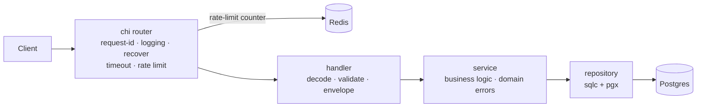

# go-boilerplate

[](https://github.com/GtFoBAE05/go-boilerplate/actions/workflows/ci.yml)


Production-ready Go HTTP API template: clone it, rename the module, copy the
example resource, and start writing business logic.

Go 1.27 · chi · pgx/sqlc · goose · Redis · OpenTelemetry · `log/slog`

## Quickstart

Prerequisites: Go 1.27.3+ and Docker Compose.

```bash
cp .env.example .env      # local settings; no .env means production defaults
docker compose up -d      # postgres, redis, jaeger, prometheus, otel-collector
go run ./cmd/api          # applies migrations when POSTGRES_MIGRATE=true
```

| Service | URL |
| --- | --- |
| API | <http://localhost:8080> |
| Jaeger | <http://localhost:16686> |
| Prometheus | <http://localhost:9090> |

Postgres uses host port **5433** and Redis **6380** to avoid native installs.
`.env.example` enables debug logs, optional Redis, and migrations on boot; the
built-in defaults are production-safe and reject boot-time migrations in
production.

```bash
curl -X POST localhost:8080/api/v1/users \
  -H 'Content-Type: application/json' \
  -d '{"name":"alice","email":"alice@example.com"}'
```

## Using this template

1. Rename the module with `go mod edit -module github.com/you/your-service`, then
   replace the old import path across the repository.
2. Update `.golangci.yml` (`module-path`, `local-prefixes`), the three `-ldflags`
   paths in `Makefile` and `Dockerfile`, `SERVICE_NAME`, image names, and the CI
   badge/repository URLs.
3. Keep the `user` vertical as the reference, or delete it once your first real
   resource is in place.

## Features

- **Type-safe SQL** — sqlc generates Go from raw SQL; no ORM or reflection.
- **Migrations** — goose files embedded in the binary; production runs them from
  a deploy job.
- **Redis rate limiting** — `REDIS_MODE=disabled|optional|required`; production
  uses a shared counter.
- **Observability** — OpenTelemetry traces and metrics over OTLP, plus
  trace-correlated `slog` logs.
- **Hardened HTTP** — strict JSON, 1 MiB body cap, deadlines, per-IP limits, and
  one response envelope.
- **Guardrail CI** — lint, `gosec`, race tests, integration tests,
  `govulncheck`, sqlc drift, `promtool`, and a Docker smoke test.

## Architecture



The graph is flat: **handler → service → repository**. Handlers never touch the
database, services never touch HTTP, and services never call another service.
Domain errors carry a `Kind` and `Code`, so the HTTP layer maps them generically.

```text
cmd/api/              entry point
internal/app/         lifecycle + dependency wiring
internal/config/      config, defaults, validation
internal/platform/    generic infra: postgres, redis, ratelimit, telemetry, errors
internal/repository/  sqlc output + transaction store
internal/service/     use-case services (user is the example)
internal/handler/     HTTP plumbing + resource handlers
internal/server/      router, middleware, http.Server, pprof
db/                   migrations and sqlc queries
deploy/               collector, Jaeger, Prometheus, alert rules
```

`internal/platform/` may not import application code; `depguard` enforces it.
Only the composition layer may import `internal/config`.

## API

| Method | Path | Description |
| --- | --- | --- |
| POST | `/api/v1/users` | Create user (409 on duplicate email) |
| GET | `/api/v1/users/{id}` | Get user |
| GET | `/api/v1/users` | List users (`?limit=1..100&offset=`) |
| PATCH | `/api/v1/users/{id}` | Partial update |
| DELETE | `/api/v1/users/{id}` | Delete user (404 if missing) |
| GET | `/healthz` | Liveness probe |
| GET | `/readyz` | Readiness: Postgres, plus Redis when configured |

There is no `/metrics` endpoint; metrics are pushed to the collector.

### Response envelope

Every API response has one shape. Health probes skip it.

```jsonc
// success
{"data": {"id": 1, "name": "alice"}}

// list
{"data": [...], "meta": {"limit": 20, "offset": 0}}

// failure
{"error": {"code": "VALIDATION_FAILED", "message": "...", "fields": {"email": "is required"}}}
```

Clients branch on `error.code`, never on `message`. Optional `details` carries
structured context.

### Request guardrails

| Area | Behavior |
| --- | --- |
| Body | 1 MiB cap; unknown/duplicate JSON fields rejected; validation failures return 422 |
| Pagination | `limit` 1–100, non-negative `offset`; malformed values return 422 |
| Rate limit | Per client IP; 429 over limit; Redis failure fails closed with 503 |
| Timeouts | `server.request_timeout` aborts downstream work and returns 504 `TIMEOUT` |
| Headers | `Cache-Control: no-store`, `nosniff`, `Allow` on 405, `Retry-After` on 429/503 |
| Request ID | Short alphanumeric IDs (plus `-_.`) are kept; others are replaced |

Business rules are validated in the handler, repeated in the service, and
enforced by the database (`CHECK`, `lower(email)` unique index).

### Error codes

Transport codes live in `internal/handler`: `BAD_REQUEST`, `VALIDATION_FAILED`,
`NOT_FOUND`, `METHOD_NOT_ALLOWED`, `PAYLOAD_TOO_LARGE`, `RATE_LIMITED`,
`RATE_LIMIT_UNAVAILABLE`, `TIMEOUT`, `INTERNAL`.

Domain codes live with the error:

```go
var ErrOrderLocked = service.NewError("ORDER_LOCKED", service.KindConflict, "order is locked")
```

`WriteServiceError` maps `Kind` to a status and preserves `%w` wrapping.

## Configuration

Configuration is environment-only: **environment > `.env` > built-in default**.
`.env.example` is the source of truth. Every key is registered, defaulted, and
validated at boot; all errors are reported together.

Production defaults: `SERVICE_ENV=production`, `REDIS_MODE=required`,
`POSTGRES_MIGRATE=false`, JSON logs at `info`, `PPROF_ENABLED=false`.
`.env.example` is the local-development opt-in.

Gotchas:

- Kubernetes injects variables such as `POSTGRES_PORT`; current keys use
  `POSTGRES_DSN` and `REDIS_ADDR` to avoid collisions.
- `OTEL_*` uses the SDK's own names and semantics. `OTEL_METRIC_EXPORT_INTERVAL`
  is milliseconds, the OTLP endpoint requires a scheme, and `OTEL_SERVICE_NAME`
  is not read because `SERVICE_NAME` owns identity.
- Behind pgbouncer or RDS Proxy, set `POSTGRES_QUERY_EXEC_MODE=exec` or
  `simple_protocol`; `cache_statement` needs server-side prepared statements.

Dependencies:

- **Postgres** is required; an unreachable database at startup is fatal.
- **Redis** is `disabled`, `optional`, or `required`. Optional Redis that is
  unreachable at startup reports `degraded` on `/readyz` and stays 200. If the
  rate limiter is using Redis, a later Redis failure fails readiness (503)
  because the limiter fails closed.
- Production rate limiting needs a shared counter. Production with optional or
  disabled Redis fails boot unless `RATELIMIT_ALLOW_PROCESS_LOCAL=true`.
- Production migrations belong to the deploy pipeline, not the app. Redis TLS
  verification is on by default and skipping it is rejected in production.

## Database and migrations

Goose SQL lives in `db/migrations/`, is embedded in the binary, and is applied at
boot only when `POSTGRES_MIGRATE=true`. Production rejects that setting.

```bash
make migrate-up
make migrate-status
make migrate-down       # roll back one migration

# production, from a dedicated job
DB_DSN='postgres://...' make migrate-up
```

The database role needs DDL permissions. sqlc reads the migrations as its
schema, so generated code stays in sync.

## Observability

- **Traces**: Jaeger at <http://localhost:16686>; logs carry `trace_id` and
  `span_id`.
- **Metrics**: Prometheus at <http://localhost:9090>, scraping the collector.
  The app pushes over OTLP and serves no `/metrics`.
- **Profiling**: pprof on a private loopback listener, off by default. Enable it
  with `PPROF_ENABLED=true`, then run
  `go tool pprof http://localhost:6060/debug/pprof/profile`.

Push metrics have no `up` signal: a dead app and a dead collector look the same.
`deploy/rules.yml` uses `AppMetricsMissing` and `CollectorDown` together.

| Series | Source | Answers |
| --- | --- | --- |
| `http_server_request_duration_seconds` | otelhttp | rate, errors, latency |
| `pgxpool_*` | `otelpgx.RecordStats` | pool saturation |
| `db_client_connections_*` | redisotel | Redis pool |
| `go_*` | runtime instrumentation | goroutines, heap, GC |
| `target_info` | OTel resource | build provenance |

Keep labels bounded: `http_route` is the chi pattern, `instance` is the replica.
Never label with a user id, email, or `trace_id`.

## Development

```bash
make test               # go test -race ./...
make test-integration   # testcontainers suite
make lint               # golangci-lint
make gosec              # security scan
make sqlc               # regenerate internal/repository
make sqlc-diff          # fail if generated code is stale
make vuln               # govulncheck
make migrate-new name=x # scaffold a migration
make build              # local binary with provenance
make docker-build       # production image
```

Tool versions are pinned in the Makefile and CI; they stay out of `go.mod` so the
Docker build does not download sqlc's dependency tree. The integration suite
starts a throwaway `postgres:16-alpine` and applies the real migrations. CI also
validates the alert rules with `promtool`.

## Extending

1. `make migrate-new name=create_things` and write the up/down SQL.
2. Add queries in `db/queries/`, then run `make sqlc`.
3. Copy `internal/service/user/` and `internal/handler/user/`; follow the
   `Input`/`Output` conventions in `AGENTS.md`.
4. Wire the service in `internal/app/di.go`, add it to `server.Deps`, and mount
   routes in `internal/server/server.go`.

`cmd/` and `app.go` should not need to change for a new resource.

## Philosophy

This template makes the decisions everyone agrees on and leaves the contested
ones to you. Deliberately not included: authentication, Swagger/OpenAPI, mock
generators, CORS/trusted-proxy handling, gRPC, queues, and workers.

The `user` vertical is the complete example: copy it, rename it, ship it. AI
coding agents should read [AGENTS.md](AGENTS.md); this README is for humans.
