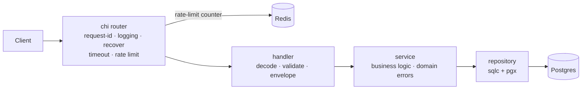

# go-boilerplate

[](https://github.com/GtFoBAE05/go-boilerplate/actions/workflows/ci.yml)


Production-ready Go HTTP API template: clone it, rename the module, copy the
example resource, and start writing business logic.

Go 1.27 · chi · pgx/sqlc · goose · Redis · OpenTelemetry · `log/slog`

## Quickstart

Prerequisites: Go 1.27.3+ and Docker Compose.

```bash
cp .env.example .env       # local settings; no .env means production defaults (and no DSN)
make docker-up-all         # postgres + redis + Loki/Tempo/Mimir/Grafana/collector
make run-observability     # API with JSON logs teed to .tmp/logs/api.log
```

| Service | URL |
| --- | --- |
| API | <http://localhost:8080> |
| Grafana UI | <http://localhost:3000> |
| Loki API | <http://localhost:3100> |
| Tempo API | <http://localhost:3200> |
| Mimir API | <http://localhost:9009/prometheus> |

Grafana is the entry point: its datasources are provisioned automatically. The
API applies migrations when `POSTGRES_MIGRATE=true`. `make docker-up-all` starts
both compose files; `make observability-up` starts only the observability stack.

Logs reach Loki only through `make run-observability`, which tees stdout into
`.tmp/logs/api.log`; the collector tails that file. `make run` and a plain
`go run ./cmd/api` leave logs in the terminal. If you run without the
observability stack, set `OTEL_SDK_DISABLED=true` to avoid failed OTLP exports.

Postgres uses host port **5433** and Redis **6380** to avoid native installs.
`.env.example` enables debug logs, optional Redis, and migrations on boot; the
built-in defaults are production-safe, require an explicit DSN (and an OTLP
endpoint while telemetry is enabled), and reject boot-time migrations in
production.

```bash
curl -X POST localhost:8080/api/v1/users \
  -H 'Content-Type: application/json' \
  -d '{"name":"alice","email":"alice@example.com"}'
```

## Using this template

1. Rename the module with `go mod edit -module github.com/you/your-service`, then
   replace the old import path across the repository.
2. Update `.golangci.yml` (`module-path`, `local-prefixes`), the three `-ldflags`
   paths in `Makefile` and `Dockerfile`, `SERVICE_NAME`, the `resource/logs`
   `service.name` in `deploy/otel-collector.yaml`, image names in `deploy/k8s/`,
   the `job` label in `deploy/rules.yml`, and the CI badge/repository URLs.
   `TestAlertRulesUseServiceName` fails if the rule label and `SERVICE_NAME`
   drift apart.
3. Keep the `user` vertical as the reference, or delete it once your first real
   resource is in place.

## Features

- **Type-safe SQL** — sqlc generates Go from raw SQL; no ORM or reflection.
- **Migrations** — goose files embedded in the binary; production runs them from
  a deploy job.
- **Redis rate limiting** — `REDIS_MODE=disabled|optional|required`; production
  uses a shared counter.
- **Observability** — OpenTelemetry traces and metrics over OTLP, trace-correlated
  `slog` logs, and a local LGTM stack (Loki, Grafana, Tempo, Mimir).
- **Hardened HTTP** — strict JSON and content type, 1 MiB body cap, deadlines,
  trusted-proxy-aware per-IP limits, and one response envelope.
- **Safe data access** — server-side statement/lock/idle timeouts, rollback
  cleanup after a canceled request, and an advisory-locked migration job.
- **Guardrail CI** — SHA-pinned actions, digest-pinned images, lint, `gosec`,
  race and integration tests, `govulncheck`, sqlc drift, `promtool`, Trivy,
  Compose validation, and a Docker smoke test.

## Architecture



The graph is flat: **handler → service → repository**. Handlers never touch the
database, services never touch HTTP, and services never call another service.
Domain errors carry a `Kind` and `Code`, so the HTTP layer maps them generically.

```text
cmd/api/              HTTP entry point
cmd/migrate/          advisory-locked migration job
internal/app/         lifecycle + dependency wiring
internal/config/      config, defaults, validation
internal/platform/    generic infra: postgres, redis, ratelimit, telemetry, errors
internal/repository/  sqlc output + transaction store
internal/service/     use-case services (user is the example)
internal/handler/     HTTP plumbing + resource handlers
internal/server/      router, middleware, http.Server, pprof
db/                   migrations and sqlc queries
deploy/               collector, Loki, Tempo, Mimir, Grafana, alert rules, k8s base
```

`internal/platform/` may not import application code; `depguard` enforces it.
Only the composition layer may import `internal/config`.

## API

| Method | Path | Description |
| --- | --- | --- |
| POST | `/api/v1/users` | Create user (409 on duplicate email) |
| GET | `/api/v1/users/{id}` | Get user |
| GET | `/api/v1/users` | List users (`?limit=1..100&offset=`) |
| PATCH | `/api/v1/users/{id}` | Partial update |
| DELETE | `/api/v1/users/{id}` | Delete user (404 if missing) |
| GET | `/healthz` | Liveness probe |
| GET | `/readyz` | Readiness: Postgres, plus Redis when configured |

There is no `/metrics` endpoint; metrics are pushed to the collector.

### Response envelope

Every API response has one shape. Health probes skip it.

```jsonc
// success
{"data": {"id": 1, "name": "alice"}}

// list
{"data": [...], "meta": {"limit": 20, "offset": 0}}

// failure
{"error": {"code": "VALIDATION_FAILED", "message": "...", "fields": {"email": "is required"}}}
```

Clients branch on `error.code`, never on `message`. Optional `details` carries
structured context.

### Request guardrails

| Area | Behavior |
| --- | --- |
| Body | 1 MiB cap; unknown/duplicate JSON fields rejected; validation failures return 422 |
| Content type | JSON writes require `application/json` or `+json`; otherwise 415 |
| Pagination | `limit` 1–100, non-negative `offset`; malformed values return 422 |
| Rate limit | Per client IP; 429 over limit; Redis failure fails closed with 503 |
| Proxies | `X-Forwarded-For` is honored only when the TCP peer is in `SERVER_TRUSTED_PROXY_CIDRS` |
| Timeouts | `server.request_timeout` aborts downstream work and returns 504 `TIMEOUT` |
| Headers | `Cache-Control: no-store` on every response, `nosniff`, `Allow` on 405, `Retry-After` on 429/503 |
| Request ID | A valid `X-Request-Id` is kept and echoed; otherwise one is generated and echoed |

Business rules are validated in the handler, repeated in the service, and
enforced by the database (`CHECK`, `lower(email)` unique index).

### Error codes

Transport codes live in `internal/handler`: `BAD_REQUEST`, `VALIDATION_FAILED`,
`NOT_FOUND`, `METHOD_NOT_ALLOWED`, `PAYLOAD_TOO_LARGE`, `UNSUPPORTED_MEDIA_TYPE`,
`RATE_LIMITED`, `RATE_LIMIT_UNAVAILABLE`, `TIMEOUT`, `INTERNAL`.

Domain codes live with the error:

```go
var ErrOrderLocked = service.NewError("ORDER_LOCKED", service.KindConflict, "order is locked")
```

`WriteServiceError` maps `Kind` to a status and preserves `%w` wrapping.

## Configuration

Configuration is environment-only: **environment > `.env` > built-in default**.
`.env.example` is the source of truth. Every key is registered, defaulted, and
validated at boot; all errors are reported together.

Production defaults: `SERVICE_ENV=production`, `REDIS_MODE=required`,
`POSTGRES_MIGRATE=false`, JSON logs at `info`, `PPROF_ENABLED=false`.
There is deliberately no default `POSTGRES_DSN`, and no default OTLP endpoint
while telemetry is enabled: a deployment must set them explicitly. Production
rejects a Postgres DSN that does not verify the server certificate
(`sslmode=verify-ca` or `verify-full`). `.env.example` is the local-development
opt-in.

Gotchas:

- Kubernetes injects variables such as `POSTGRES_PORT`; current keys use
  `POSTGRES_DSN` and `REDIS_ADDR` to avoid collisions.
- `OTEL_*` uses the SDK's own names and semantics. `OTEL_METRIC_EXPORT_INTERVAL`
  is milliseconds, the OTLP endpoint requires a scheme, and `OTEL_SERVICE_NAME`
  is not read because `SERVICE_NAME` owns identity.
- Behind pgbouncer or RDS Proxy, set `POSTGRES_QUERY_EXEC_MODE=exec` or
  `simple_protocol`; `cache_statement` needs server-side prepared statements.
- `POSTGRES_STATEMENT_TIMEOUT`, `POSTGRES_LOCK_TIMEOUT`, and
  `POSTGRES_IDLE_IN_TRANSACTION_TIMEOUT` are enforced by Postgres, so canceled
  requests cannot leave queries or locks behind. `POSTGRES_MAX_CONN_LIFETIME_JITTER`
  spreads reconnects across replicas.
- `SERVER_TRUSTED_PROXY_CIDRS` is empty by default. Set it to the ingress or
  load-balancer CIDRs (comma-separated) so rate limiting keys off the real
  client; never trust `X-Forwarded-For` from an arbitrary peer.

Dependencies:

- **Postgres** is required; an unreachable database at startup is fatal.
- **Redis** is `disabled`, `optional`, or `required`. Optional Redis that is
  unreachable at startup reports `degraded` on `/readyz` and stays 200. If the
  rate limiter is using Redis, a later Redis failure fails readiness (503)
  because the limiter fails closed.
- Production rate limiting needs a shared counter. Production with optional or
  disabled Redis fails boot unless `RATELIMIT_ALLOW_PROCESS_LOCAL=true`.
- Redis TLS verification is on by default; skipping it is rejected in
  production.
- Production migrations belong to the deploy pipeline, not the app.
- `POSTGRES_MIGRATION_DSN` is used only by `cmd/migrate`. In production it must
  point at a DDL role, so the runtime role never needs `CREATE`/`ALTER`/`DROP`.

## Database and migrations

Goose SQL lives in `db/migrations/`, is embedded in the binary, and is applied at
boot only when `POSTGRES_MIGRATE=true`. Production rejects that setting.

```bash
make migrate-up         # local convenience (goose CLI, DB_DSN)
make migrate-status
make migrate-down       # roll back one migration

# production: a dedicated job, serialized by a Postgres advisory lock
go run ./cmd/migrate
docker build --target migrate -t registry.example.com/app-migrate:VERSION .
```

`cmd/migrate` uses `POSTGRES_MIGRATION_DSN` when set, otherwise `POSTGRES_DSN`
in development. In production the migration DSN is required and must verify TLS.
The advisory lock makes concurrent rollout jobs wait instead of racing.
`deploy/postgres/roles.sql` is a starting point for splitting the DDL role from
the runtime DML role. sqlc reads the migrations as its schema, so generated code
stays in sync.

## Kubernetes

`deploy/k8s/` is a kustomize base with a two-replica Deployment, probes,
resource requests/limits, a PodDisruptionBudget, an HPA, and a default-deny
NetworkPolicy. The migration Job is a separate overlay in `deploy/k8s/migrate`
so it can run before the rollout. It is a starting point: replace the image
names, ingress namespace, and RFC1918 egress ranges with your environment's.

```bash
# 1. Create the namespace, service account, config, and secrets. Copy the
#    example, edit the copy, and keep it out of git (secret.yaml is ignored).
cp deploy/k8s/secret.example.yaml deploy/k8s/secret.yaml
kubectl apply -f deploy/k8s/namespace.yaml
kubectl apply -f deploy/k8s/serviceaccount.yaml
kubectl apply -f deploy/k8s/configmap.yaml
kubectl apply -f deploy/k8s/secret.yaml

# 2. Run migrations before the rollout. Delete a completed Job first so a new
#    image actually runs; wait for completion before touching the Deployment.
kubectl -n go-boilerplate delete job go-boilerplate-migrate --ignore-not-found
kubectl apply -k deploy/k8s/migrate
kubectl -n go-boilerplate wait --for=condition=complete \
  job/go-boilerplate-migrate --timeout=10m

# 3. Apply the application.
kubectl apply -k deploy/k8s
```

The Deployment's `terminationGracePeriodSeconds` is 35s, above the app's 5s
drain delay plus 20s shutdown. Readiness uses `/readyz`; liveness uses
`/healthz`, so a draining pod leaves rotation without being killed. The
namespace enforces the restricted Pod Security Standard. The HPA needs
metrics-server; the NetworkPolicy assumes an `ingress-nginx` namespace and
private-range access to Postgres, Redis, and the OTLP collector.

## Observability

Start the local LGTM stack with `make observability-up`, then run the API with
`make run-observability` so stdout JSON is teed to `.tmp/logs/api.log`. The
target creates `.tmp/logs` before Compose mounts it; if you invoke Compose
directly, run `mkdir -p .tmp/logs` first.

- **Grafana**: <http://localhost:3000>. The Mimir, Loki, and Tempo datasources
  are provisioned; Grafana runs as anonymous admin locally.
- **Logs**: app stdout JSON → `.tmp/logs/api.log` → collector `file_log` →
  Loki. The app never pushes logs. Only bounded values become Loki labels;
  `trace_id`, `request_id`, and `path` stay in the JSON body, so query with
  `| json`. Grafana's derived field turns `trace_id` into a Tempo link.
- **Traces**: app OTLP → collector → Tempo. Paste a `trace_id` into Grafana
  Explore (Tempo) or open it from a Loki log line.
- **Metrics**: app OTLP → collector's Prometheus exporter → collector
  `prometheus/self` scrape → Mimir remote write. Grafana queries Mimir. The app
  serves no `/metrics`.
- **Alert rules**: the one-shot `mimir-rules` service loads `deploy/rules.yml`
  into Mimir's ruler with `mimirtool`. Reload after edits with
  `make observability-rules`. There is no Alertmanager locally, so rules
  evaluate but do not notify.
- **Profiling**: pprof on a private loopback listener, off by default. Enable it
  with `PPROF_ENABLED=true`, then run
  `go tool pprof http://localhost:6060/debug/pprof/profile`.

These compose files are local development configuration: filesystem storage, no
auth, no TLS, and no replication. Production needs object storage, tenant
isolation, and a real retention policy.

The app is push-only, so it has no `up` series of its own. The collector scrapes
its own Prometheus exporter, which produces `up{job="otel-collector"}`; both a
failed scrape and a missing series are failure signals. `AppMetricsMissing` and
`CollectorDown` together distinguish an app problem from a pipeline problem.
Alert links below are the runbook sections in this README.

SLO: 99.9% of API requests succeed (non-5xx) over 30 days, and p99 latency stays
below 1s. Error-budget burn is evaluated over multiple windows: 14.4x over 5m and
1h pages within 2m; 6x over 30m and 6h pages after 15m.

| Series | Source | Answers |
| --- | --- | --- |
| `http_server_request_duration_seconds` | otelhttp | rate, errors, latency |
| `pgxpool_*` | `otelpgx.RecordStats` | pool saturation |
| `db_client_connections_*` | redisotel | Redis pool |
| `go_*` | runtime instrumentation | goroutines, heap, GC |
| `target_info` | OTel resource | build provenance |

Keep labels bounded: `http_route` is the chi pattern, `instance` is the replica.
Never label with a user id, email, or `trace_id`.

## Runbook

App metrics are pushed, not scraped, so the absence of data is ambiguous. The
collector is the only scrape target, and it scrapes itself. Check
`CollectorDown` and `AppMetricsMissing` together first; if both fire, the
pipeline is broken and every other metric alert is blind rather than healthy.
Request log lines carry `trace_id` and `span_id`; paste the `trace_id` into
Grafana Explore (Tempo). `target_info{service_version}` identifies the build
behind a series, so a regression that starts at a version boundary is a
rollback.

### AppMetricsMissing

No `go_goroutine_count` series for three minutes. The app, the collector, or the
network between them is down. If `CollectorDown` also fires, restart the
collector and verify the `prometheus` exporter on port 8889 plus the
`prometheus/self` scrape in `deploy/otel-collector.yaml`. If only this alert
fires, check the app's liveness probe and recent logs; Kubernetes should restart
a wedged process. If both sides look healthy, inspect egress to
`OTEL_EXPORTER_OTLP_ENDPOINT` and the collector's Mimir remote-write logs.

### CollectorDown

The collector's self-scrape is missing or failing
(`absent(up{job="otel-collector"})` or `up{job="otel-collector"} == 0`), or its
remote write to Mimir is broken. Restart it and verify the `prometheus` exporter
on port 8889, the `prometheus/self` receiver, and the Mimir remote-write logs.
Keep `honor_labels: true` in `deploy/otel-collector.yaml` or the app's
`job`/`instance` labels are overwritten with the collector's identity. Treat
other metric alerts' silence as unknown, not healthy, until this clears.

### ErrorBudgetBurnFast

More than 14.4x the 99.9% error budget is burning across both 5m and 1h. Break
down by `http_route` and `http_response_status_code`, then follow a `trace_id`
from the error logs. Check the most recent deploy first; roll back a regression
that starts at a version boundary instead of debugging forward.

### ErrorBudgetBurnSlow

A 6x burn across 30m and 6h exhausts the monthly budget in about five days.
Look for a steady background error rate introduced by a deploy, a dependency
change, or a traffic shift. This is page-worthy because it is not self-limiting.

### HighLatencyP99

p99 is above the 1s SLO for ten minutes. Check
`instance:pgxpool_connections:utilization` and `PostgresPoolStarved` first: an
exhausted pool shows up as time spent acquiring a connection, not as an error.
Then check Redis latency and the slowest `http_route`.

### PostgresPoolSaturated

A replica is using more than 90% of `POSTGRES_MAX_CONNS` for five minutes.
Either raise the pool size or find the query holding connections; at 100% every
new request queues.

### PostgresPoolStarved

Requests are waiting on an empty pool more than once per second. This is the
leading indicator before saturation and latency breach. Find the slow query or
the connection leak; raising `POSTGRES_MAX_CONNS` only moves the wall.

## Development

```bash
make docker-up          # postgres + redis
make docker-up-all      # plus Loki, Tempo, Mimir, Grafana, otel-collector
make observability-up   # observability only
make observability-down # stop observability only
make observability-rules # reload deploy/rules.yml into Mimir
make run-observability  # API with JSON logs teed to .tmp/logs/api.log
make test               # go test -race ./...
make test-integration   # testcontainers suite
make lint               # golangci-lint
make gosec              # security scan
make sqlc               # regenerate internal/repository
make sqlc-diff          # fail if generated code is stale
make vuln               # govulncheck
make migrate-new name=x # scaffold a migration
make build              # local binary with provenance
make docker-build       # production image
make docker-build-migrate # migration-only image
```

Tool versions are pinned in the Makefile and CI; they stay out of `go.mod` so the
Docker build does not download sqlc's dependency tree. The integration suite
starts a throwaway `postgres:16-alpine` and applies the real migrations. CI also
validates the alert rules with `promtool`.

## Extending

1. `make migrate-new name=create_things` and write the up/down SQL.
2. Add queries in `db/queries/`, then run `make sqlc`.
3. Copy `internal/service/user/` and `internal/handler/user/`; follow the
   `Input`/`Output` conventions in `AGENTS.md`.
4. Wire the service in `internal/app/di.go`, add it to `server.Deps`, and mount
   routes in `internal/server/server.go`.

`cmd/` and `app.go` should not need to change for a new resource.

## Philosophy

This template makes the decisions everyone agrees on and leaves the contested
ones to you. Deliberately not included: authentication, Swagger/OpenAPI, mock
generators, CORS, gRPC, queues, and workers.

The `user` vertical is the complete example: copy it, rename it, ship it. AI
coding agents should read [AGENTS.md](AGENTS.md); this README is for humans.
