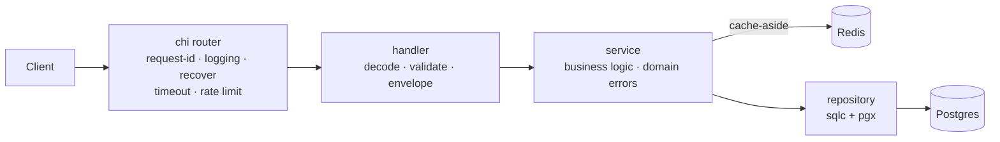

# go-boilerplate

[](https://github.com/GtFoBAE05/go-boilerplate/actions/workflows/ci.yml)


Production-ready Go HTTP API boilerplate: clone it, rename the module, copy the
example resource, and start writing business logic. Community-standard layout
(thin `cmd/`, private code in `internal/`, flat packages — no over-nesting).

## Features

- **Type-safe SQL** — [sqlc](https://sqlc.dev) generates Go from raw SQL; no ORM, no reflection
- **Versioned migrations** — [goose](https://github.com/pressly/goose) files embedded in the binary, applied at boot (or from CI in prod)
- **Cache-aside Redis** — optional by config: disabled / degrade-gracefully / required
- **Full observability** — OTel traces (handler → service → SQL/Redis), Prometheus metrics, trace-correlated `slog` logs
- **Hardened HTTP** — single response envelope, per-IP rate limiting, request timeouts, 1 MiB body cap, strict JSON validation
- **Private pprof** — profiling on a localhost-only port, never on the public API
- **Guardrail CI** — lint (pinned version), race tests, testcontainers integration suite, `govulncheck`, sqlc drift check, Dependabot
- **Graceful shutdown** — bounded drain for HTTP, OTel flush, and connections

## Architecture



Every layer owns one job: handlers never touch the database, services never
touch HTTP, repositories never contain business rules. Domain errors flow up
and are mapped to HTTP exactly once (`internal/handler/respond.go`).

## Quickstart

Prerequisites: Go 1.25+, Docker.

```bash
docker compose up -d      # postgres + redis + jaeger + prometheus + otel-collector
go run ./cmd/api          # or: make run — applies goose migrations at boot
```

Postgres binds host port **5433** and Redis **6380** (not the defaults) so they
never collide with natively installed instances.

### Endpoints

| Method | Path                 | Description                              |
| ------ | -------------------- | ---------------------------------------- |
| POST   | `/api/v1/users`      | Create user (409 on duplicate email)     |
| GET    | `/api/v1/users/{id}` | Get user (second call served from Redis) |
| GET    | `/api/v1/users`      | List users (`?limit=&offset=`)           |
| PATCH  | `/api/v1/users/{id}` | Partial update (name and/or email)       |
| DELETE | `/api/v1/users/{id}` | Delete user                              |
| GET    | `/healthz`           | Liveness probe                           |
| GET    | `/readyz`            | Readiness (pings postgres + redis)       |
| GET    | `/metrics`           | Prometheus metrics                       |

```bash
curl -X POST localhost:8080/api/v1/users -d '{"name":"alice","email":"alice@example.com"}'
curl localhost:8080/api/v1/users/1
```

## Stack

| Concern       | Choice                                                                 |
| ------------- | ---------------------------------------------------------------------- |
| HTTP router   | [chi](https://github.com/go-chi/chi) (stdlib-compatible)               |
| Database      | PostgreSQL via [pgx/v5](https://github.com/jackc/pgx) connection pool  |
| Query layer   | [sqlc](https://sqlc.dev) — type-safe Go generated from SQL             |
| Migrations    | [goose](https://github.com/pressly/goose) — embedded, applied at boot  |
| Cache         | Redis via [go-redis/v9](https://github.com/redis/go-redis), cache-aside |
| Config        | [Viper](https://github.com/spf13/viper) — `config.yaml` + `APP_*` env overrides |
| Logging       | stdlib `log/slog`, JSON in prod, trace-ID correlated                   |
| Tracing       | OpenTelemetry → OTLP/gRPC (Jaeger, Tempo, any collector)               |
| Metrics       | OpenTelemetry → Prometheus exporter on `/metrics`                      |

## Layout

```
cmd/api/              Entry point: calls app.Run(), never changes
internal/
  app/                Lifecycle (app.go, stable) + DI wiring (di.go, grows per resource)
  config/             Viper config loading (yaml + env)
  logger/             slog setup
  observability/      OTel tracer/meter providers
  postgres/           pgxpool construction + goose migration runner
  redis/              Redis client lifecycle (shared by all Redis consumers)
  cache/              JSON cache-aside helper (one consumer of the client)
  repository/         sqlc-generated queries (run `make sqlc`) + hand-written Store (tx wrapper)
  service/            Shared service bits: domain errors, storage-error helpers
    user/             User business logic: service.go, model.go, input.go
  handler/            Shared HTTP plumbing: respond, validate
    health/           Liveness/readiness probes
    user/             /users resource: handler.go, request.go, response.go, routes.go
  server/             Router, middleware, http.Server, private pprof listener
db/
  migrations/         goose SQL migrations (embedded, applied at boot)
  queries/            sqlc query sources
deploy/               Prometheus + OTel collector configs for the local stack
```

## API behavior

### Response envelope

Every API response has exactly one shape, enforced centrally in
`internal/handler/respond.go` — resource handlers never touch the encoder:

```jsonc
// success                              // failure
{"data": {...}}                         {"error": {"code": "NOT_FOUND", "message": "..."}}
{"data": [...], "meta": {"limit": 20,   {"error": {"code": "VALIDATION_FAILED", "message": "...",
           "offset": 0}}                           "fields": {"email": "is required"}}}
```

Clients branch on `error.code` (machine-readable), never on `message`.
Health probes (`/healthz`, `/readyz`) intentionally skip the envelope.

### Request guardrails

- **Validation**: DTOs carry [go-playground/validator](https://github.com/go-playground/validator)
  tags; failures return 422 with per-field messages. Unknown JSON fields are
  rejected (typos fail loudly). Bodies over 1 MiB return 413.
- **Rate limiting**: the `/api/v1` subtree is limited per client IP via
  [httprate](https://github.com/go-chi/httprate); probes and `/metrics` are
  never limited. Over the limit → `429` with the `RATE_LIMITED` envelope.
  Configure under `ratelimit`; disable with `APP_RATELIMIT_ENABLED=false`.
- **Timeouts**: every request gets a context deadline (`server.request_timeout`);
  downstream pgx/redis calls abort when it fires.

## Configuration

`config.yaml` holds development defaults. Any key is overridable via env var:
`server.port` → `APP_SERVER_PORT`, `postgres.dsn` → `APP_POSTGRES_DSN`,
`otel.enabled` → `APP_OTEL_ENABLED`. In containers, ship no file and configure
entirely through env.

### Dependency policy

- **Postgres is a hard dependency**: unreachable at startup → the process
  exits (fail-fast, let the orchestrator restart it).
- **Redis is a soft dependency**, controlled by `redis.mode`:
  - `disabled` — no Redis at all, service runs uncached.
  - `optional` (default) — log a warning and degrade to uncached reads
    when unreachable; `/readyz` reports Redis as `degraded` but stays 200.
  - `required` — unreachable Redis is fatal at startup.

## Observability

- **Traces**: Jaeger UI at <http://localhost:16686> — spans run
  handler → service → SQL/Redis, correlated with logs via `trace_id`.
- **Metrics**: Prometheus at <http://localhost:9090>, scraped from `/metrics`.
- **Profiling**: pprof on a private `localhost`-only port
  (`server.pprof_port`, `0` disables), never on the public API port —
  e.g. `go tool pprof http://localhost:6060/debug/pprof/profile`.

## Development

```bash
make test               # unit tests: go test -race ./... (fast, no Docker)
make test-integration   # integration suite (-tags integration, needs Docker)
make lint               # golangci-lint (CI pins the same version)
make sqlc               # regenerate internal/repository after editing db/queries/
make migrate-new name=x # scaffold a goose migration in db/migrations/
make migrate-up         # apply migrations to the local db
make docker-build       # distroless production image
```

The integration suite spins a throwaway `postgres:16-alpine` via
[testcontainers](https://github.com/testcontainers/testcontainers-go), applies
the goose migrations (guarding them too), and exercises the repository. See
`internal/repository/integration_test.go` — it is the template for new
resources.

### Migrations

Schema changes are goose SQL files under `db/migrations/` (`-- +goose Up` /
`-- +goose Down` in one file), embedded in the binary and applied at boot while
`postgres.migrate` is true — the default for local dev; disable it in prod and
run goose from CI instead. sqlc reads the same migration files as its schema,
so nothing is kept in sync by hand.

## Extending

- **New resource** (mirror the `user` vertical):
  1. `make migrate-new name=create_things` → write the up/down SQL
  2. Add queries in `db/queries/` → `make sqlc`
  3. Copy the layout of `internal/service/user/` and `internal/handler/user/`
     (handlers import their service aliased: `thingsvc ".../service/thing"`)
  4. Wire it: construct the service in `internal/app/di.go`, add a field to
     `server.Deps`, mount the routes in `internal/server/server.go` —
     `cmd/` and `app.go` stay untouched.
- **New binary** (worker, cron): add `cmd/<name>/main.go`, reuse `internal/`.

## Philosophy

A boilerplate should make the decisions everyone agrees on and leave the
contested ones to you. Deliberately **not** included:

- **Auth** — JWT vs sessions vs an external provider is a per-project decision
- **Swagger/OpenAPI** — annotation noise; pick your own spec workflow
- **Mock generators** — interfaces + hand-written fakes are enough (see the tests)
- **CORS / trusted-proxy handling** — depends on your deployment topology;
  add middleware in `internal/server/` to fit it
- **gRPC / message queues / workers** — add them when you need them

One complete example vertical (`user`) is the documentation: copy it, rename
it, ship. AI coding agents get their own guidance in [AGENTS.md](AGENTS.md).
